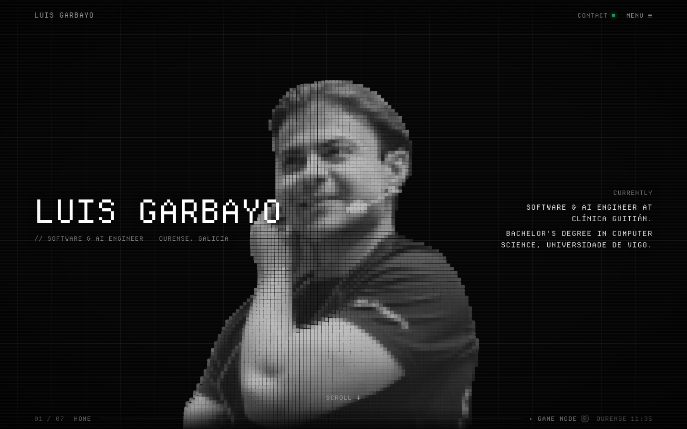
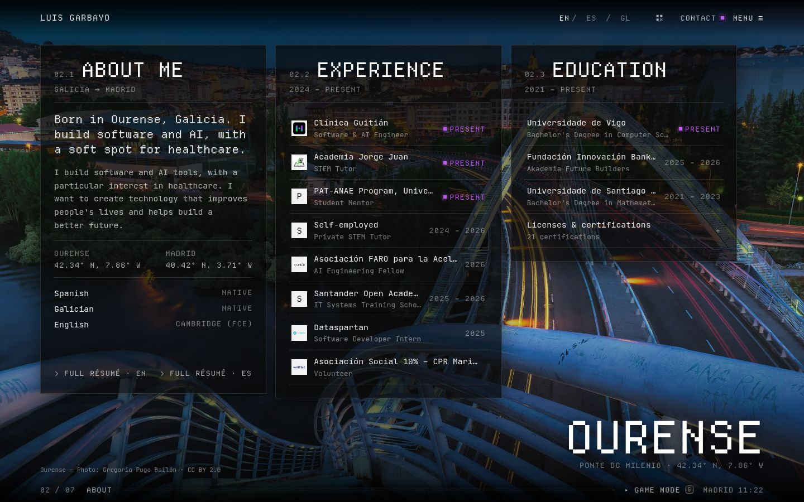
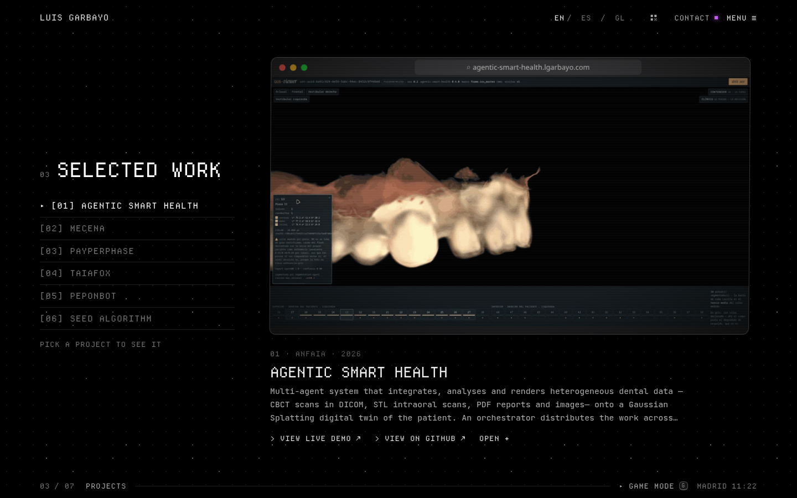
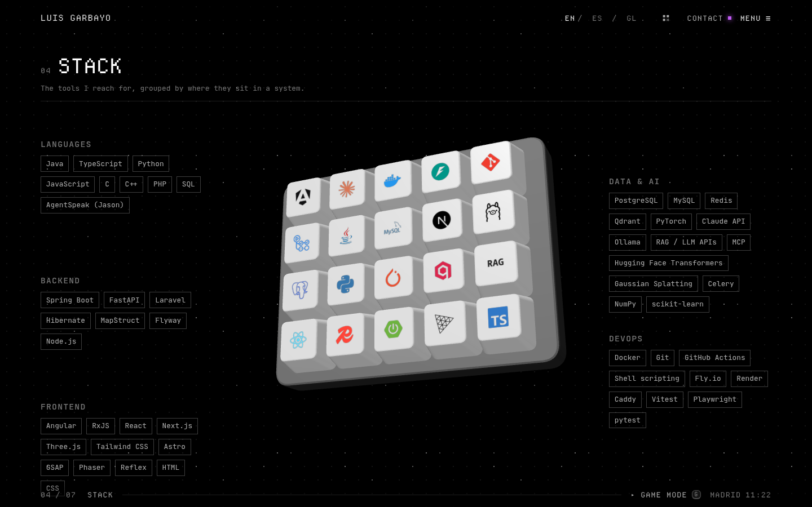
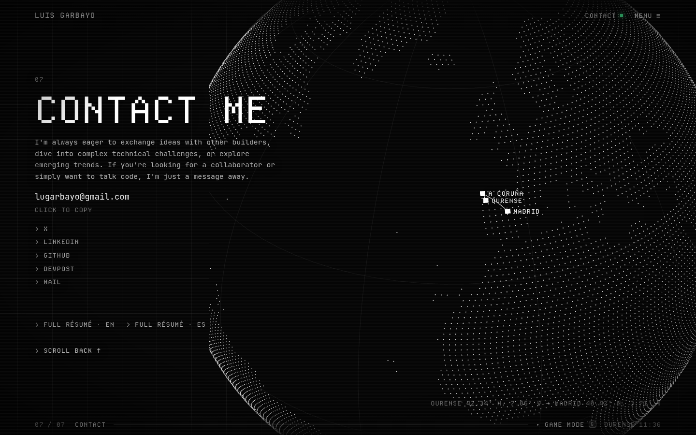
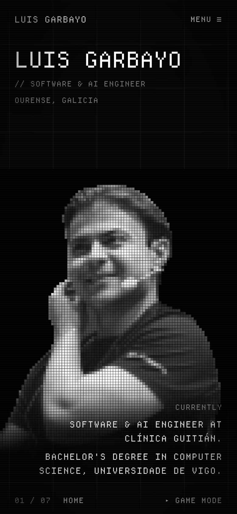
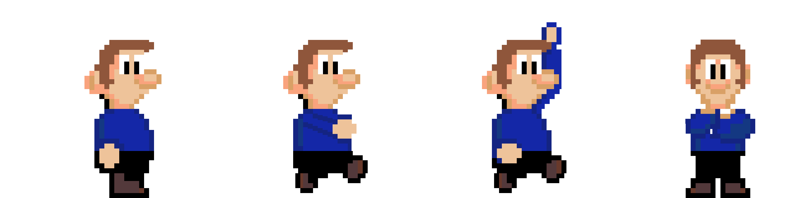

# Luis Garbayo — Portfolio

> Software & AI engineering, healthcare technology, and a playable portfolio.

[Visit lgarbayo.com](https://lgarbayo.com) · [Blog](https://lgarbayo.com/en/blog/) · [Medium](https://medium.com/@lugarbayo)



## About

My personal portfolio brings together my work in software and AI, with a particular
interest in healthcare and building technology that improves people's lives.

The site is available in **English, Spanish and Galician**, dark only, and styled like a
screen: a black background lit by a grid of pixels, a pixel typeface, a header with the
languages and a QR code, and a bottom bar with the current section and the time in Madrid.
Some pieces borrow the look of macOS windows — the Terminal in the hero, a Safari window
for the projects, the detail sheets, the QR and the links page. Its original 2D game
remains available through **Game Mode**, using the same portfolio content as the main
website.

## Website previews

### Home

A Terminal window answers `whoami`, `cat role.txt` and `cat now.md`, typed once per
visit. Next to it, a colour cutout of my photo drawn by a small WebGL shader: it resolves
from a coarse mosaic on arrival, follows the cursor like a card (or the tilt of the phone),
and glitches like a CRT now and then. Nothing in it distorts the face.

### About, experience and education

Three glass panels over photos of Ourense, A Coruña and Madrid. The photos stay pinned
while the cities change behind the panels, on every screen size; each change cuts like a
TV channel. Each entry opens a detail sheet with tasks, photos and links.



### Selected work

A numbered list of featured projects next to a Safari window with the project's address.
Scrolling or picking a project changes the window; *Open +* shows its key points, stack
and links. On phones the list becomes a row of numbers above the window. Below, the
rest of the projects and other activities.



### Interactive stack

A 3D keyboard displays technology logos in color. Hover or tap a key to explore it,
drag to rotate the board, and optionally enable key sounds. The technology lists remain
readable when WebGL or animation is unavailable.



<details>
<summary>Contact and mobile hero</summary>

A dotted globe facing Galicia draws the route Ourense → A Coruña → Madrid.



On mobile the Terminal sits above the portrait, and the header menu holds the sections
and the languages.



</details>

Screenshots are stored in `docs/images/` and show the local production build.

## Motion

- **Between pages:** the screen dissolves into pixel blocks, the new page loads behind
  them, and it comes back with a CRT flicker.
- **Between sections:** while scrolling, the edge between two sections breaks into pixels
  and a scan band rolls down the screen; when you stop, the blocks switch off and nothing
  is left on top of the content. Section titles type themselves the first time they show.
- **While loading:** images, the portrait, the keyboard and the CV viewer show pixel
  skeletons — the portrait's is a block silhouette of the cutout.

Everything has a still fallback: with reduced motion, without WebGL or without JavaScript
the same content is there, without the effects.

## Portfolio sections

1. **Home:** the Terminal with name, role and what I am doing now, and the portrait.
2. **About:** About, Experience and Education as panels over three cities, with
   languages, certifications and English/Spanish CVs.
3. **Projects:** featured work in a Safari window, more projects and other activities.
4. **Stack:** an interactive keyboard and technology categories.
5. **In the press:** coverage in HISTORA, Faro de Vigo, La Voz de Galicia, Atlántico and La Región.
6. **Blog:** the latest articles; the full index, tag pages and localized RSS feeds live
   under `/blog`, with a link to my articles on Medium.
7. **Contact:** email (click to copy), links and the globe.

Every page links to the others: subpages have a way back and a breadcrumb, and end with
cards to the next place to go (previous and next article, the blog index, home, the links
page). `/links` — where the QR in the header points — gathers every channel in one list.

## Game Mode

Inspired by the **iconic worlds of Super Mario Bros**, the game features custom-designed
character sprites and four worlds — about, projects, experience and contact — that blend
nostalgia with the portfolio. Its panels share the website's profile, projects,
experience, education, languages, certifications, activities and press links. It plays
with the keyboard or with touch controls.



## Tech Stack

**Astro** and **TypeScript** for the site, **Phaser 3** for the game, **Three.js** for
the keyboard and the globe, **GSAP** for the reveals, and plain WebGL for the portrait.
Titles and labels use **Departure Mono**; body text uses **JetBrains Mono**.

The engines load on demand: Phaser only when you open game mode, Three.js only when the
keyboard or the globe is about to scroll into view — on any device, with WebGL and without
reduced motion; everyone else gets the same content without the 3D. `npm run build` fails
if either engine ends up in a page's initial payload.

## Development

```bash
npm install
npm run dev          # local dev server
npm run build        # type check, build, translation coverage, asset and bundle checks
npm run preview      # serve the production build
npm run medium:sync  # refresh the saved copy of the Medium feed
```

The development server defaults to `http://localhost:4321`. Opening `/` selects
the visitor's language and lands on the hero; the name in the header also returns there.

For a quick validation without generating a production build:

```bash
npm run check
npm run coverage:i18n
```

## Structure

```text
src/
  content/      portfolio content as validated collections (one file per entry, per locale)
  data/         a saved copy of the Medium feed, used when Medium does not answer
  i18n/         interface strings (en.json is the contract; es.json and gl.json translate it)
  components/   layout, sections, the header menu, the bottom bar and page links
  game/         the Phaser game — host.ts is its only entry point
  lib/          shared data and client behaviour (sections, transitions, portrait, 3D, game)
public/assets/  committed images, logos, flags, city photos and game assets
docs/images/    website screenshots used in this README
scripts/        build-time checks, the Medium sync and the portrait and globe generators
```

Adding a project, a job or a blog post means adding a file under `src/content/` — no
component needs editing.

Press articles live in `src/lib/press.ts`. Project selection and order are shared
through `getPortfolioProjects()` in `src/lib/content.ts`, so the website and Game Mode
show the same projects.

## Content and locales

English is the default locale. `/en/`, `/es/` and `/gl/` are all prefixed, and `/` redirects
based on stored preference, then browser language. Content falls back to English when a
translation is missing — blog posts included: they are listed in every locale, labelled as
untranslated, and link to the URL where the article actually exists.

Adding a locale means adding it to `src/i18n/config.ts` (which also holds the BCP-47 tag used
for date formatting), a `src/i18n/<code>.json` dictionary, and one `<slug>.<code>.md` per
content entry. `npm run build` reports what is still missing.

Astro watches content files while `npm run dev` is running. Keep `.astro/` intact:
the development server uses its generated files and content store. Neither `dev`
nor `build` deletes this directory, so a build can run alongside the development server.

## Blog

Articles are Markdown files in `src/content/posts/`, named `<slug>.<locale>.md` like the rest
of the content. Four fields are required — `title`, `description`, `pubDate` and `slug` — and
`draft: true` keeps a post visible in `npm run dev` while hiding it from production, the feed
and the sitemap. An optional `motion` clip (with its `motionAlt`) appears at the top of
the article card and links to the article; it only plays on screen, and never with
reduced motion.

Every locale gets a feed at `/<locale>/rss.xml`. Opening one in a browser shows a readable
page rather than raw XML — that is `public/rss/styles.xsl`, a stylesheet the browser applies
on its own, leaving the file itself untouched for feed readers. The Blog section and menu
entry appear only once a published post exists.

**Medium.** I also publish on [Medium](https://medium.com/@lugarbayo). The blog and the home
page link to it, and the links page shows it next to the blog with its article count. The
build reads the Medium RSS feed (`src/lib/medium.ts`); if Medium does not answer, it uses the
copy in `src/data/medium-feed.xml`, which `npm run medium:sync` refreshes.

## Analytics

Google Analytics 4, and it stays off unless you turn it on. The whole thing hangs off one
environment variable:

```bash
PUBLIC_GA_ID=G-XXXXXXXXXX   # Analytics → Admin → Data streams → the web stream
```

Leave it unset — as `.env.example` does — and no tag, no consent banner and no request to
Google survive the build. That is the default for local work and for anyone who clones this.

Two things the default GA setup would get wrong here, both handled in code:

- **Navigation is client-side.** The `ClientRouter` moves between pages with `pushState`, so
  the automatic page view only ever fires once. Page views are sent by hand on
  `astro:page-load`, after the swap, which is the only moment the title is right. Turn off
  *Page changes based on browser history events* in Enhanced Measurement or every navigation
  counts twice.
- **Most of the site isn't a link.** The QR, the CV viewer, game mode, the detail sheets, the
  keyboard scene, the shortcuts — none of them change the URL. They send their own events,
  declared either as `data-track` attributes in the markup or as `track()` calls in the
  module that owns the interaction.

Consent is Google's consent mode, denied by default, and only for measurement: the three
advertising signals stay denied for good and are never asked about.

`src/lib/analytics.ts` has the full reasoning and the event list.

## Generated media

Everything the site serves is committed, so a build never runs a model; the only thing
it fetches is the Medium feed, and it has a saved copy for when that fails. Two scripts
regenerate the generated pieces; their sources live in the gitignored `assets-src/`.

**Hero portrait** — `scripts/portrait/make_portrait.py` cuts the person out of
`assets-src/portrait/luis-source.jpg` with SAM (Segment Anything, ViT-H), using a box and a
few positive and negative points, and writes `public/assets/ui/portrait.webp` (the colour
cutout with alpha, which is also the still fallback) and `portrait.json` (its size and the
block silhouette used as its loading skeleton). The mask is cached next to the source, so
reframing does not need a GPU.

```bash
python scripts/portrait/make_portrait.py            # uses the cached mask
python scripts/portrait/make_portrait.py --refresh  # runs SAM again (CUDA if available)
```

**Contact globe** — `scripts/globe/make_globe.py` rasterizes Natural Earth's 1:50m land
polygons (downloaded on first run) into a 720×360 mask, `globe-land.png`, which the browser
samples into dots, and draws the static `contact-globe.webp`.

**City photos** — `public/assets/places/` holds the three backgrounds of the About section,
resized and slightly darkened. Their authors, licences and source pages are in
`public/assets/places/sources.json` and are credited on the page.

**Favicon** — a minifigure of me, cut out with the same SAM model and cropped to the head
and shoulders, in the three sizes the site uses (`public/favicon-16.png`, `-32` and `-180`).

## License

MIT — see [LICENSE.md](LICENSE.md).

© 2026 Luis Garbayo Fernández

## Additional Credits

- **Character Sprite**: Custom design by Luis Garbayo Fernández
- **Typeface**: [Departure Mono](https://departuremono.com) by Helena Zhang, SIL Open Font License 1.1
- **City photos** (Wikimedia Commons): *Ponte do Milenio, Ourense* by Gregorio Puga Bailón (CC BY 2.0);
  *Torre de Hércules* by Galajatuna (CC BY-SA 3.0 ES); *Edificio España and Gran Vía at night* by Tim Adams (CC BY 3.0)
- **Land polygons**: [Natural Earth](https://www.naturalearthdata.com), public domain
- **Segmentation**: [Segment Anything](https://github.com/facebookresearch/segment-anything) (SAM ViT-H), Apache 2.0
- **Game Inspiration**: Super Mario Bros® is a registered trademark of Nintendo Co., Ltd.
  This project is a personal portfolio and is not affiliated with, endorsed by, or connected to Nintendo.
